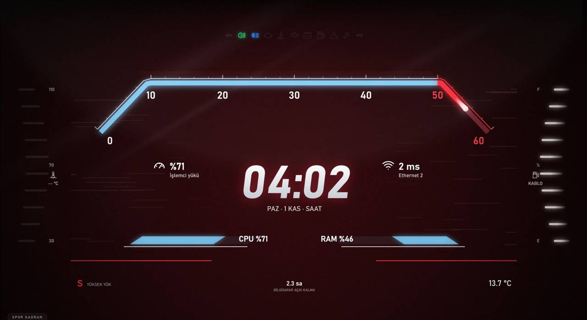
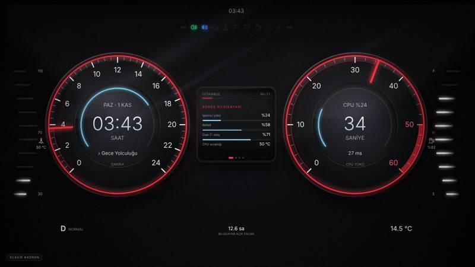
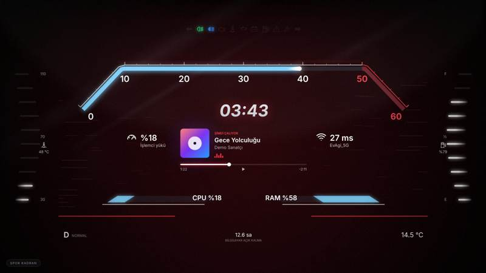
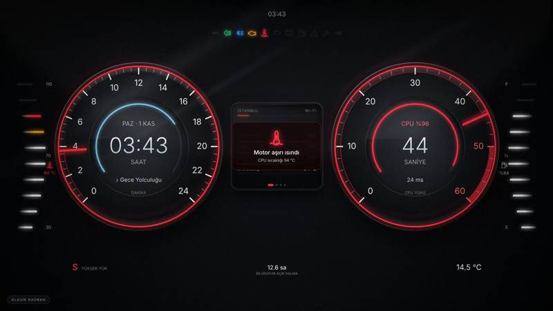

# Wallpaper Engine için Dijital Gösterge Paneli
### Car-Style Digital Dashboard Live Wallpaper for Wallpaper Engine

**[🇹🇷 Türkçe](#-türkçe) · [🇬🇧 English](#-english)**

| Klasik Kadran · Classic | Spor Kadran · Sport | Uyarı · Warning |
|---|---|---|
|  |  |  |

---

## 🇹🇷 Türkçe

Windows masaüstünü bir otomobilin dijital gösterge paneline çeviren, **Wallpaper Engine** için açık kaynak bir canlı duvar kağıdı.
Hız ve devir kadranlarının yerinde **saat** ve **saniye** var. Yakıt göstergesi **Wi-Fi sinyalini**, hararet göstergesi **işlemci sıcaklığını** gösteriyor. Uyarı ışıkları bilgisayarın gerçek durumuna bağlı.

### Özellikler

- **İki mod:** *Klasik Kadran* (iki yuvarlak kadran ve ortada çerçeveli bilgi ekranı) ve *Spor Kadran* (yatay saniye barı ve büyük dijital saat). Mod elle değiştirilir.
- **Gerçek araç davranışı:** açılışta ışık testi ve ibre turu, yaylı ibreler, her dakikanın son 5 saniyesinde vites uyarısı gibi yanıp sönen halka.
- **Canlı sistem verisi:** CPU yükü, RAM, C: diski, CPU sıcaklığı, Wi-Fi sinyali, ping, indirme ve yükleme hızı, açık kalma süresi.
- **Müzik:** Spotify veya YouTube Music çalarken albüm kapağı, şarkı bilgisi ve süre çubuğu.
- **Hava durumu:** [Open-Meteo](https://open-meteo.com) üzerinden, API anahtarı gerekmez.
- **Cam ve derinlik:** ön cam yansımaları, lekeler, cam dokusu, güneşlik gölgesi ve fareyle çalışan paralaks.
- **Kişiselleştirme:** Wallpaper Engine panelinden vurgu rengi, mod, şehir ve sayfa süresi.

### Göstergeler

| Gösterge | Gösterdiği veri |
|---|---|
| Sol kadran | Saat (0–24), içteki mavi halka dakikayı gösterir |
| Sağ kadran | Saniye (50–60 kırmızı bölge), içteki halka CPU yükünü gösterir |
| Sol merdiven (hararet) | CPU sıcaklığı, 30–110 °C |
| Sağ merdiven (yakıt) | Wi-Fi sinyal kalitesi (kabloluda tam) |
| Vites (P N D S) | P boşta · D normal · S yüksek yük · N veri yok |

| Uyarı ışığı | Ne zaman yanar |
|---|---|
| ⬅ / ➡ sinyaller | Yükleme / indirme yapılırken |
| Kısa far / uzun far | İnternet bağlıyken / gece saatlerinde (19:00–07:00) |
| Motor arıza | CPU yükü %90'ın ya da sıcaklık 85 °C'nin üstündeyken |
| Hararet | CPU 90 °C ve üstündeyken |
| Yağ basıncı | RAM %90 ve üstü doluyken |
| Akü | C: diski %90 ve üstü doluyken |
| Yakıt | Wi-Fi zayıfken (sarı) / bağlantı yokken (kırmızı) |
| Ünlem | Ping 150 ms'nin üstündeyken |
| Anahtar (servis) | Telemetri scripti çalışmıyorken |

### Kurulum

1. **Code → Download ZIP** ile indir ve kalıcı bir klasöre çıkar.
2. Wallpaper Engine'de **Duvar Kağıdı Aç → Dosyadan aç** yolunu izleyip `wallpaper/index.html` dosyasını seç.
3. `telemetri/Baslangica-Ekle.bat` dosyasına çift tıkla. Script hemen başlar ve her açılışta kendiliğinden çalışır. Yönetici yetkisi gerekmez.
4. CPU sıcaklığı için [LibreHardwareMonitor](https://github.com/LibreHardwareMonitor/LibreHardwareMonitor)'u kur ve *Options → Remote Web Server → Run* seçeneğini aç.
5. Wallpaper Engine ayarlarında **Medya entegrasyonu** ve **fare girişi** açık olmalı.

Sorun giderme için [`wallpaper/KURULUM.txt`](wallpaper/KURULUM.txt) dosyasına bak. Göstergelerde "VERİ YOK" yazıyorsa `telemetri/Test-Et.bat` dosyasını çalıştır.

### Nasıl çalışıyor

Wallpaper Engine web duvar kağıtlarına sistem verisi vermiyor. Bu yüzden küçük bir PowerShell scripti (`telemetri/PC-Telemetri.ps1`) verileri toplayıp yalnızca **yerel bilgisayarda** (`http://localhost:8765/`) JSON olarak sunuyor. Dışarıya hiçbir veri gönderilmez. Ayrıntılar için [`docs/MIMARI.md`](docs/MIMARI.md) dosyasına bak.

### Geliştirme ve katkı

Wallpaper Engine olmadan tarayıcıda deneyebilirsin: `wallpaper/index.html?demo` (örnek verilerle) ya da `?demo&sport`. Bütün arayüz tek bir HTML dosyasında, harici kütüphane yok. Katkı kuralları [`CONTRIBUTING.md`](CONTRIBUTING.md) dosyasında. Fikirler ve hata bildirimleri için **Issues** sayfasını kullanabilirsin.

**Yol haritası:** GPU göstergesi · İngilizce arayüz · yeni temalar · Lively Wallpaper desteği · çoklu monitör · ayarlanabilir uyarı eşikleri

---

## 🇬🇧 English

An open-source live wallpaper for **Wallpaper Engine** that turns your Windows desktop into a car's digital instrument cluster.
Instead of speed and RPM, the dials show the **hour** and the **seconds**. The fuel gauge shows your **Wi-Fi signal**, the coolant gauge shows your **CPU temperature**, and every warning light is wired to your PC's real state.

### Features

- **Two modes:** *Classic* (two round dials with a framed info display in the middle) and *Sport* (horizontal seconds bar with a large digital clock). You switch modes manually.
- **Real car behaviour:** a bulb check and needle sweep at start-up, spring-loaded needles, and a shift-light ring that flashes during the last 5 seconds of every minute.
- **Live system data:** CPU load, RAM, C: drive, CPU temperature, Wi-Fi signal, ping, download/upload speed and uptime.
- **Music:** album art, track info and a progress bar while Spotify or YouTube Music is playing.
- **Weather:** via [Open-Meteo](https://open-meteo.com), no API key needed.
- **Glass and depth:** windshield reflections, smudges, glass grain, a hood shadow and mouse parallax.
- **Customisation:** accent colour, mode, city and page duration from the Wallpaper Engine panel.

### Gauges

| Gauge | Shows |
|---|---|
| Left dial | Hour (0–24); the inner blue ring shows the minute |
| Right dial | Seconds (red zone 50–60); the inner ring shows CPU load |
| Left ladder (coolant) | CPU temperature, 30–110 °C |
| Right ladder (fuel) | Wi-Fi signal quality (full on Ethernet) |
| Gear (P N D S) | P idle · D normal · S high load · N no data |

| Warning light | Lights up when |
|---|---|
| ⬅ / ➡ indicators | Uploading / downloading |
| Low / high beam | Online / night time (19:00–07:00) |
| Check engine | CPU load above 90% or temperature above 85 °C |
| Coolant | CPU at 90 °C or higher |
| Oil pressure | RAM 90% or more in use |
| Battery | C: drive 90% or more full |
| Fuel | Weak Wi-Fi (amber) / offline (red) |
| Exclamation | Ping above 150 ms |
| Spanner (service) | Telemetry script not running |

### Installation

1. **Code → Download ZIP** and extract it to a permanent folder.
2. In Wallpaper Engine choose **Open Wallpaper → Open from File** and select `wallpaper/index.html`.
3. Double-click `telemetri/Baslangica-Ekle.bat`. The script starts now and on every boot. No admin rights are needed.
4. For CPU temperature, install [LibreHardwareMonitor](https://github.com/LibreHardwareMonitor/LibreHardwareMonitor) and enable *Options → Remote Web Server → Run*.
5. Turn on **Media integration** and **mouse input** in Wallpaper Engine's settings.

If the gauges show "VERİ YOK" (no data), run `telemetri/Test-Et.bat`. The in-app text and the detailed guide (`wallpaper/KURULUM.txt`) are in Turkish.

### How it works

Wallpaper Engine doesn't give web wallpapers any system data. A small PowerShell script (`telemetri/PC-Telemetri.ps1`) collects it and serves it as JSON **only on your own machine** (`http://localhost:8765/`). Nothing is sent anywhere else. See [`docs/MIMARI.md`](docs/MIMARI.md) for the data format (in Turkish).

### Development and contributing

You can try it in a browser without Wallpaper Engine: `wallpaper/index.html?demo` (sample data) or `?demo&sport`. The whole UI is a single HTML file with no external libraries. Contribution guidelines are in [`CONTRIBUTING.md`](CONTRIBUTING.md). Ideas and bug reports are welcome in **Issues**.

**Roadmap:** GPU gauge · English UI · new themes · Lively Wallpaper support · multi-monitor layouts · configurable warning thresholds

---

## Lisans · License

[MIT](LICENSE) © erentuncayy

> Bu proje bağımsız, kişisel bir çalışmadır ve hiçbir otomobil üreticisiyle ilişkisi yoktur.
> This is an independent personal project and is not affiliated with any car manufacturer.
